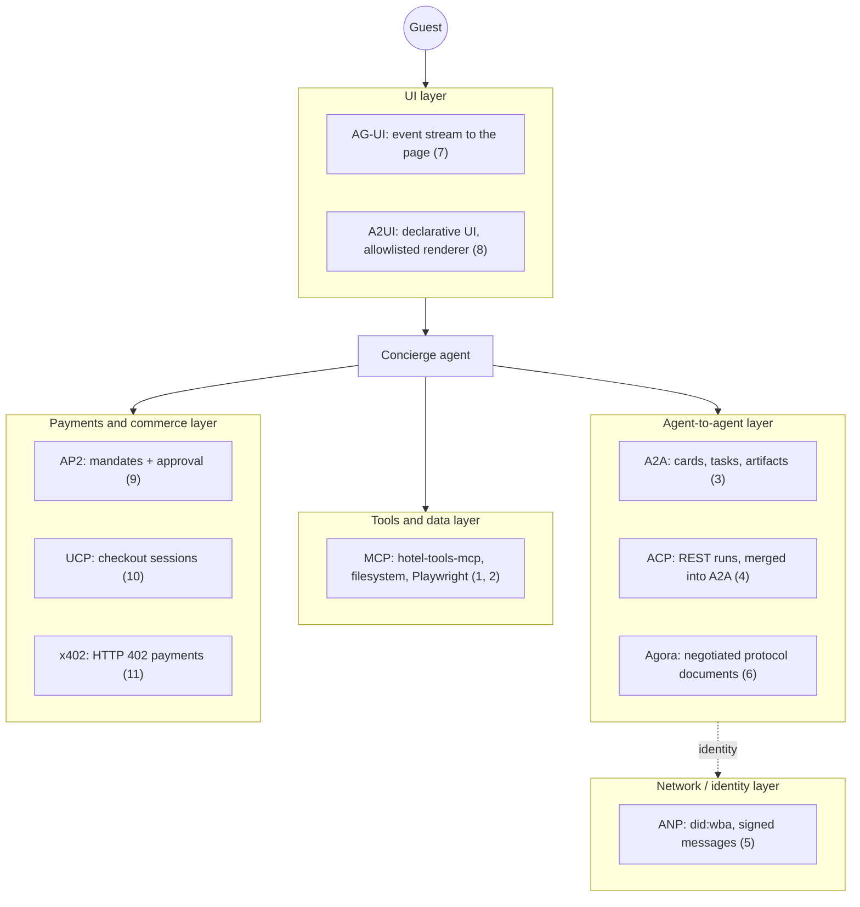

# Agent Protocols Lab

[](https://github.com/vamsialladev/agent-protocols-lab/actions/workflows/ci.yml)

[](https://github.com/astral-sh/ruff)
[](LICENSE)

One small, working, tested demo per agent protocol: MCP, A2A, ACP, ANP, Agora, AG-UI, A2UI, AP2, UCP and x402, all in
the same hotel scenario. It's part of a **simulated client engagement** for a fictional hotel group, and **all data is
synthetic**. No real money, network payments, wallets or keys anywhere.

<!-- DEMO-VIDEO -->

There's no live demo for this repo: everything runs locally in about 20 seconds (`make test`).

## At a glance

| | |
|---|---|
| **Problem** | Agent protocols arrive faster than anyone can read their specs, and several have merged, been renamed or stopped. It's hard to know which one solves which problem, and what it costs to adopt. |
| **Solution** | Eleven demos, one per protocol (MCP twice), each with the official SDK where one is usable, a README, tests, and the guardrail that matters for it. |
| **Measured** | 47 tests pass, plus 1 live test run locally (needs Node and Chrome), 86% coverage, ruff clean. One live model run (Agora negotiation, Claude Haiku 5.5): agreed in 3 turns, about $0.0005. |
| **Cost** | $0 to run: no API key needed except for `demos.agora --live`. |

## The problem

When I wired the hotel apps together (stage 6's concierge calling stage 7's tool server over MCP and stage 2's guest
email agent over A2A), each protocol choice was a small research project. Is ACP still alive? Does AP2 have a
Python SDK? Is the `ap2` package on PyPI the real one? (It isn't.) This lab is that research, done once, with code
that runs, so the next decision takes minutes.

## What it does

| # | Protocol | Layer | Demo | Built with |
|---|---|---|---|---|
| 1 | [MCP (server)](demos/mcp_server/) | tools / data | A client starts the stage 7 hotel-tools-mcp server over stdio as two roles; each sees only its tools | `mcp` 2.3 |
| 2 | [MCP (consumer)](demos/mcp_consumer/) | tools / data | One agent uses the official filesystem server, Microsoft's Playwright server and hotel-tools-mcp behind a gateway: tool allowlist, read-only scopes, origin allowlist, audit | `mcp` 2.3, npx |
| 3 | [A2A](demos/a2a/) | agent-to-agent | The concierge delegates a guest email (agent card, task lifecycle, artifact); a reader and an ideas agent turn a brochure into ideas | `a2a-sdk` 1.2.3 |
| 4 | [ACP](demos/acp/) | agent-to-agent | The same delegation over ACP's REST runs, side by side with A2A; an outline → draft → edit chain | `acp-sdk` 1.0.3 (archived) |
| 5 | [ANP](demos/anp/) | network | Two agents with local did:wba identities authenticate and exchange signed messages; replay, tampering, stale messages and a forged DID document are refused | `anp` 1.0.7 |
| 6 | [Agora](demos/agora/) | agent-to-agent | Two agents talk in prose, negotiate a protocol document, then switch to structured messages identified by its hash | `agora-protocol` 0.2.0 core, copied (MIT) |
| 7 | [AG-UI](demos/ag_ui/) | UI | A backend streams AG-UI events over SSE to a small page: text, a tool call, state, a human approval | `ag-ui-protocol` 1.0 |
| 8 | [A2UI](demos/a2ui/) | UI | The agent returns a declarative booking card; the renderer allowlists components and runs no agent code | `a2ui-core` 0.3.0 |
| 9 | [AP2](demos/ap2/) | payments | Intent, cart and payment mandates with signatures, limits and an explicit guest approval; sandbox | AP2 SDK, tag v0.2.0 |
| 10 | [UCP](demos/ucp/) | commerce | Discover, cart, quote, guest confirms, complete, against a mock merchant | UCP spec v2026-08-25, validated with `ucp-sdk` 0.5.0 |
| 11 | [x402](demos/x402/) | payments | An API answers HTTP 402; the agent pays a fully mocked payment and retries | `x402` 2.25.0 |

What I found along the way changed two of my own repos:

- The Agora package can't be imported without its LangChain stack, and pip-audit flagged 18 known vulnerabilities
  in the versions it pins. The demo carries the few functions it needs instead (copied under the MIT license).
- Demo 1 started the stage 7 server from a fresh install, and its first search printed a progress line to stdout.
  Over stdio, stdout *is* the MCP stream, so that line corrupted it. That's fixed in hotel-tools-mcp (decision 14).
- Connecting the concierge to stage 7 as a guest (before this lab) showed `search_policy` returning a passage marked
  "CONFIDENTIAL - INTERNAL STAFF USE ONLY". Staff-only documents are now left out for guests (decision 13 there).

## Architecture



Every demo writes the same audit log (`src/protolab/audit.py`): one trace ID per run, the actor, the event, and
secrets masked before anything is kept. The tests read it to check what happened, in order.

## Results

Run on Windows 11, Python 3.12.10, 2026-10-27:

- `pytest`: **47 passed, 1 skipped** (demo 2's live test, opt-in with `LAB_NPX=1`; it passed when run locally),
  coverage **86%** of `demos/` and `src/`.
- Demo 6 live (Claude Haiku 5.5, once): the model concierge proposed a document with a `boolean` field the format
  doesn't allow, the model operator pointed it out and fixed it, and the concierge accepted. Then both used the field
  names they had agreed on. 1,317 input / 789 output tokens, about $0.0005
  ([log](docs/agora-live-run.txt)). One run, so it shows the flow works, not how often.
- Demo 7 checked in a browser: 48 events, the approval card, the state update after Approve, no console errors.
- Demo 2 live (2026-10-27): the official filesystem server (1.0.0) and Microsoft's Playwright server (0.0.83),
  both pinned and provenance-checked. The filesystem server's only root was a fresh folder inside the lab, and it
  refused a read outside it on its own. Playwright ran headless with a fresh profile against a local synthetic page.
  The gateway refused the write, the unsafe browser tool and the outside URL before they reached a server
  ([evidence](demos/mcp_consumer/README.md#live-run-2026-10-27-windows-11-node-24221-npx-11191-python-31210)).
- Demo 10 with the official `ucp-sdk`: the first, spec-only version failed 6 of 9 SDK checks (handler key format,
  a missing order link, an update without line items); after the fixes all 9 conform, and the run validates every
  exchange ([both runs](demos/ucp/README.md#two-runs-labelled)). pip-audit after installing the SDK: nothing new.

**What it taught me.** Two of the eleven SDKs are where the friction was. The archived `acp-sdk` needs a
uvicorn from June 2025 and a header its own client forgets, which is what "merged into A2A" looks like in practice.
AP2's official SDK pins exact versions of pydantic, cryptography and pytest, so it can't share an environment with
the others without `--no-deps`. And the control case in each test file (the normal path must still work) caught
more of my own mistakes than the attack cases did.

## Business value

This is an enablement repo, not a product, so there's no dollar projection. Who it helps: whoever has to choose a
protocol for a client (a forward deployed engineer, a solutions architect) gets a working example, the guardrail
that matters and the gotchas in one place. How I'd measure it in a pilot: time from "which protocol?" to a working
spike, before and after using the lab, on two or three real integration requests. **Not measured yet.**

## Design at scale

| Topic | Design |
|---|---|
| **Model choice and why** | **Built:** only demo 6's optional live mode calls a model: Claude Haiku 5.5, the portfolio default, because negotiating a small JSON format doesn't need more. Every other demo is deterministic so CI needs no key. |
| **PII and tenant isolation** | **Built:** synthetic data only; the A2A hand-off sends no guest name or room; MCP roles and tenants come from the stage 7 server (one key = one role and hotel group). **Roadmap:** per-tenant keys for A2A and ACP agents instead of one shared bearer token. |
| **10K → 1M users** | **What breaks first:** the in-memory stores (A2A tasks, approvals, nonces, vouchers) and one process per demo. **Roadmap:** tasks and nonces in Redis or Postgres with TTLs, A2A servers behind a load balancer (agent cards are static), streaming over SSE with backpressure, and per-agent rate limits. |
| **Monitoring, alerting, hallucination and off-brand detection** | **Built:** the audit log with trace IDs, and structured checks instead of trust (schemas for Agora bodies, catalog validation for A2UI, signatures for ANP and AP2). **Roadmap:** ship the audit log to the shared ops tables the hotel apps use (hotel-ai-platform), alert on refusal spikes. |
| **Failure modes and rollback** | **Built:** every demo has a refusal path that's tested (wrong token, replayed nonce, tampered cart, unknown component, real network offered). A down agent is a fallback, not a crash (the concierge's A2A tool). Rollback: each SDK is pinned; reverting a pin is one line. |

## Run locally

Windows (PowerShell):

```powershell
cd agent-protocols-lab
py -3.12 -m venv .venv
.venv\Scripts\pip install -r requirements-dev.txt
.venv\Scripts\pip install --no-deps -r requirements-nodeps.txt
$env:PYTHONPATH = "src"
.venv\Scripts\python -m pytest
.venv\Scripts\python -m demos.a2a.demo
```

macOS / Linux:

```bash
python3.12 -m venv .venv && . .venv/bin/activate
pip install -r requirements-dev.txt && pip install --no-deps -r requirements-nodeps.txt
make test
PYTHONPATH=src python -m demos.x402.demo
```

Docker: `docker build -t agent-protocols-lab . && docker run --rm agent-protocols-lab` runs the tests.

## Limitations and roadmap

- Demo 2's live run isn't in CI (Node and Chrome); it was run locally on 2026-10-27 and CI runs the gateway tests.
- `ucp-sdk` isn't on PyPI, so it's installed from its tag's commit archive.
- Most agents are small rule-based stand-ins so the demos are free and repeatable; the real Claude agents live in the
  hotel apps (the concierge, the guest request agent).
- x402 uses a mock scheme on a mock network on purpose: no testnet, no keys. AP2 signatures use keys made per run.
- Roadmap: a remote MCP server over Streamable HTTP with OAuth; A2A streaming; the AG-UI page driven by a real model.

## Skills demonstrated

| FDE skill | Where it shows |
|---|---|
| Reading specs and checking status before building | Each demo's README: version, creator, status, and what changed (ACP merged, AP2 not on PyPI, A2UI v0.9.1) |
| Security by default | Allowlists (MCP tools, A2UI components, payees), signatures (ANP, AP2), replay protection (ANP, AP2, x402), approvals (AG-UI, AP2, UCP) |
| Honest measurement | Control cases in every test file; what's built vs reviewed only, and what wasn't run |
| Integrating with existing systems | Demo 1 uses the stage 7 server; the bugs it found were fixed there |
| Working with imperfect SDKs | ACP's uvicorn pin and header workaround; AP2's `--no-deps` install |

## Protocol reference

| Protocol | What it solves | Creator / home | Maturity (2026-10) | When I'd use it | When I wouldn't | Security risks → guardrails here |
|---|---|---|---|---|---|---|
| MCP | Giving a model tools and data through one interface | Anthropic, now [modelcontextprotocol.io](https://modelcontextprotocol.io) | Widely adopted, spec versioned | Any tool or data access from an agent | Agent-to-agent delegation (use A2A) | Over-broad tools, prompt injection in results → per-role tools, client allowlist, read-only scopes, origin allowlist |
| A2A | One agent delegating a task to another, across vendors | Google, now [Linux Foundation](https://github.com/a2aproject/A2A) | Production SDKs (Python 1.2) | Handing work to an agent you don't own | Calling your own functions (just call them) | Unauthenticated agents, oversharing → bearer auth on all but the card, minimal data, no draft returned |
| ACP | REST messaging between agents | IBM / BeeAI; [archived](https://github.com/i-am-bee/acp) | **Merged into A2A** (Aug 2025) | Maintaining an existing ACP system | Anything new | Same as A2A; plus an unmaintained dependency tree |
| ANP | Agents finding and authenticating each other without a central registry | [ANP community](https://github.com/agent-network-protocol/AgentNetworkProtocol) | Active, SDK 1.0 | Open networks of agents from different owners | Inside one company (use your identity provider) | Impersonation, replay → DID-key binding, signed bodies, nonces, 5-minute window |
| Agora | Agents agreeing on a message format on the fly | [Marro et al., 2024](https://arxiv.org/abs/2410.11905) | Research library 0.2 | Many agent pairs with changing tasks | A fixed integration (write the schema) | Executing generated code → never run routines; validate bodies against the agreed schema |
| AG-UI | Streaming an agent's run to a front end | [ag-ui-protocol](https://github.com/ag-ui-protocol/ag-ui) | Active, SDK 1.0 | Showing tool calls, state and approvals live | Batch jobs with no UI | Rendering untrusted text → textContent only, approvals decided once |
| A2UI | An agent describing UI declaratively | Google, [a2ui-project](https://github.com/a2ui-project/a2ui) | v0.9.1 production, v1.0 draft | Rich agent answers inside your app's design system | Plain chat | UI injection, tracking pixels → official validator + narrower allowlist, escaping, named events only |
| AP2 | Proving a human approved an agent's payment | Google, [google-agentic-commerce/AP2](https://github.com/google-agentic-commerce/AP2) | v0.2.0, SDK on GitHub only | Agent-initiated payments that need an audit trail | Payments a person makes directly | Unapproved or altered payments → signed cart and payment, limits, approval, replay check |
| UCP | A common checkout API for agents and merchants | Google + Shopify, [ucp.dev](https://ucp.dev) | Spec dated releases (2026) | An agent buying from many merchants | One merchant you integrate with directly | Price tampering, double orders → catalog prices, Idempotency-Key, status gates, sandbox tokens |
| x402 | Paying for an HTTP resource with a 402 response | [x402 Foundation](https://github.com/x402-foundation/x402) | SDK 2.25 | Per-call paid APIs for agents | Anything needing refunds or invoices | Overspending, real networks → mock network only, per-call and session caps, payee allowlist, single-use vouchers |

## Other protocols (reviewed only, not built)

From [*A Survey of AI Agent Protocols*](https://arxiv.org/abs/2504.16736) (Yang et al., v3 June 2025), which sorts
protocols by context-oriented vs inter-agent and general-purpose vs domain-specific, and the
[Awesome-AIAgent-Protocol](https://github.com/zoe-yyx/Awesome-AIAgent-Protocol) list that follows it. Status checked
2026-10-27 on GitHub or arXiv.

| Name | Layer | One line | Status (checked) | Link | Here |
|---|---|---|---|---|---|
| agents.json | tools / data | A JSON contract describing an API for agents | The listed repo returns 404 | [listed link](https://github.com/wildcard-xyz/agents.json) | reviewed only |
| AITP | agent-to-agent | Agent interaction and transaction protocol (NEAR) | The listed repo returns 404 | [listed link](https://github.com/near/aitp) | reviewed only |
| AConP (Agent Connect Protocol) | agent-to-agent | REST API to invoke and configure remote agents (AGNTCY) | Spec repo archived | [spec](https://github.com/agntcy/acp-spec) | reviewed only |
| Agent Protocol | agent-to-agent | A REST API for talking to an agent | Moved to agi-inc; last push Apr 2025 | [repo](https://github.com/agi-inc/agent-protocol) | reviewed only |
| LMOS | agent-to-agent | Eclipse's platform and protocol for agents | Active (eclipse-lmos/arc, Sep 2026) | [site](https://eclipse.dev/lmos/) | reviewed only |
| LOKA | agent-to-agent | Identity, ethics and consensus layers for agents | Research paper | [arXiv 2504.10915](https://arxiv.org/abs/2504.10915) | reviewed only |
| PXP | agent-to-agent | Protocol for explanations between a human and an agent | Research paper | [arXiv 2410.20600](https://arxiv.org/abs/2410.20600) | reviewed only |
| CrowdES | domain-specific | Crowd simulation with agents | Research paper | [arXiv 2504.04756](https://arxiv.org/abs/2504.04756) | reviewed only |
| SPPs | domain-specific | Spatial population protocols | Research paper | [arXiv 2411.08434](https://arxiv.org/abs/2411.08434) | reviewed only |

## Security

What every demo shows, and where:

| Concern | How | Demos |
|---|---|---|
| Inter-agent auth | Bearer tokens (constant-time compare) on A2A and ACP, the public card or manifest only; did:wba auth headers bound to the receiver's domain | 3, 4, 5 |
| Signed messages | Ed25519 over canonical JSON (ANP); ES256 JWTs for the merchant's cart and the guest's approval (AP2); HMAC vouchers (x402, mock) | 5, 9, 11 |
| Spending limits | $200 per payment / $300 a day (AP2); $0.05 per call / $0.20 a session (x402); catalog prices only (UCP) | 9, 10, 11 |
| Replay protection | Nonces + 5-minute window (ANP); mandate IDs used once (AP2); vouchers used once (x402); Idempotency-Key (UCP) | 5, 9, 10, 11 |
| Allowlists | MCP tools per server, read-only scopes and origins; A2UI components and events; x402 payees and networks | 2, 8, 11 |
| Human approval | AG-UI approval event decided once; AP2 guest signature; UCP completes only after the guest confirms the quote | 7, 9, 10 |
| Audit logs with trace IDs | `protolab.audit.Audit`: one trace ID per run, secrets masked | all |

More in [SECURITY.md](SECURITY.md) (threat model, OWASP Top 10 for LLM applications).

## Configuration

| Variable | Default | Used by |
|---|---|---|
| `ANTHROPIC_API_KEY` | (none) | Only `python -m demos.agora.demo --live` |
| `LAB_NPX` | unset | `1` runs demo 2's live test (Node.js, network for npx, Chrome) |
| `PORT` | 8007 | Demo 7's server |

## Commands

| Command | What it does |
|---|---|
| `make test` | All tests with coverage |
| `make lint` | ruff lint and format check |
| `make audit` | pip-audit |
| `PYTHONPATH=src python -m demos.<name>.demo` | Run one demo (`mcp_server`, `mcp_consumer`, `a2a`, `acp`, `anp`, `agora`, `ag_ui`, `a2ui`, `ap2`, `ucp`, `x402`) |

## Documentation

[ARCHITECTURE](docs/ARCHITECTURE.md) · [DECISIONS](docs/DECISIONS.md) · [VIDEO_SCRIPT](docs/VIDEO_SCRIPT.md) ·
[SECURITY](SECURITY.md) · [CHANGELOG](CHANGELOG.md) · [CONTRIBUTING](CONTRIBUTING.md)

## Author

Vamsi Alla · Senior Software Engineer · [vamsialla.com](https://vamsialla.com) ·
[LinkedIn](https://www.linkedin.com/in/vamsi-alla/) · [GitHub](https://github.com/vamsialladev)

## License

MIT. See [LICENSE](LICENSE).
