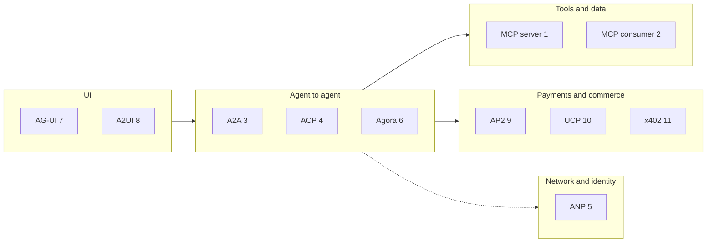

# Architecture

## Layers

## Components

| Component | What it does |
|---|---|
| `src/protolab/audit.py` | One audit log per run: trace ID, actor, event, secrets masked |
| `src/protolab/a2a_kit.py` | A function becomes an A2A agent (card, bearer auth, task lifecycle, one artifact); used by demos 3 and 4 |
| `demos/<name>/demo.py` | One demo: `main()` prints what happened; a function the tests call returns it |
| `demos/<name>/README.md` | Status, sources, guardrails, what I found |
| `tests/test_<name>.py` | The normal path, each refusal, and a control case |
| `data/` | Synthetic brochure and events page |

## How a demo runs

Everything is in-process unless the protocol is about processes: demo 1 starts hotel-tools-mcp as a real stdio
subprocess, demo 2 starts npm servers. HTTP protocols (A2A, ACP, AG-UI, UCP, x402) run their real server apps over
httpx's ASGI transport, so requests go through the same routing, middleware and serialisation as on a network.

## Scaling path (Roadmap)

Move tasks, approvals, nonces and vouchers from memory to Redis or Postgres with TTLs; run A2A agents behind a load
balancer; replace shared bearer tokens with per-tenant credentials (OAuth client credentials); resolve did:wba over
HTTPS; send the audit log to the shared ops tables the hotel apps use.
